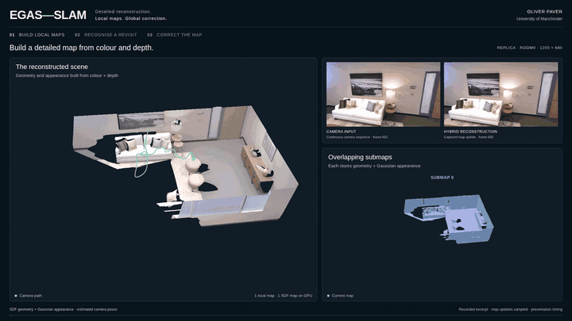

<div align="center">

# EGAS-SLAM

### Embedded Gaussian and Submap SLAM

**Detailed RGB-D reconstruction with overlapping local maps and loop closure.**

Oliver Paver · The University of Manchester · MPhil in Computer Science

[Overview](#what-egas-slam-adds) · [Results](#results-on-jetson-agx-thor) · [Installation](#installation-and-first-run) · [Documentation](#documentation) · [Citation](#citation-and-acknowledgements)

[](assets/demo/egas-slam.mp4)

**[Watch the full demonstration — 65 seconds, 1080p](assets/demo/egas-slam.mp4)**

</div>

The video follows a room reconstruction, then shows a real office revisit and
the resulting loop correction. The orange dashed path is the previous estimate;
the teal path is the corrected estimate. These are desktop recordings, replayed
for clarity. Playback speed is not processing throughput.

EGAS-SLAM extends [GPS-SLAM](https://github.com/MisEty/GPS-SLAM) into a system
that can correct accumulated drift while retaining detailed hybrid maps. It
uses a signed distance field (SDF) for surface geometry and Gaussian splats for
visual detail. Both representations are organised into coupled local submaps.
When the camera revisits a place, the system verifies the match and adjusts the
submaps' global positions and orientations together.

The implementation is primarily **C++17 and CUDA**, with Python tools for data
preparation, experiment control and evaluation. It was developed and evaluated
on **NVIDIA Jetson AGX Thor**; a tested **RTX 3070 desktop profile** is included
for continued development. This repository contains the research software
supporting an MPhil thesis.

## What EGAS-SLAM adds

- **Coupled local maps.** SDF geometry and Gaussian appearance share submap
  ownership. Overlapping candidate maps, guarded handoffs and local optimisation
  policies let reconstruction continue as the camera moves through the scene.
- **Verified loop closure.** Image matching and depth-based geometric checks
  establish revisits. A guarded sparse pose graph performs **rigid submap-level
  hybrid map correction**: geometry, appearance and associated camera poses move
  together, while voxels and Gaussian parameters remain in local coordinates.
- **Resource management.** Passive SDF submaps can be paged out, cached on the
  CPU and reloaded on demand. Local Gaussian update policies control optimisation
  work. These mechanisms address device residency and processing cost; they do
  not impose a fixed bound on the entire saved map.
- **Native GPU engineering.** CUDA numerical and synchronisation repairs,
  reusable RGB-D input buffers, tracking without supplied camera poses, embedded build
  support, corrected export and reproducible measurement support make the
  system usable beyond its initial desktop prototype.

GPS-SLAM supplies the original Gaussian–SDF hybrid representation and builds on
InfiniTAM tracking/fusion and Gaussian rasterisation. EGAS-SLAM extends these
components with submap management, verified correction and deployment engineering.
See the [architecture guide](docs/ARCHITECTURE.md) for the runtime flow and the
files implementing each component.

## Results on Jetson AGX Thor

In the four-system comparison, EGAS-SLAM achieved the highest mean observed-view
reconstruction quality and processing throughput on Replica, together with the
lowest mean peak container memory. It also had the lowest equal-sequence mean
final-corrected trajectory error on the three tested TUM sequences.
Compared with MemGS, the closest external competitor on mean Replica image
quality and processing throughput, EGAS-SLAM achieved **5.56 dB higher PSNR
and 33% higher throughput**.

| System | TUM ATE ↓ (cm) | Replica PSNR ↑ (dB) | Replica processing FPS ↑ | Replica mean peak container memory ↓ (GiB) |
| --- | ---: | ---: | ---: | ---: |
| **EGAS-SLAM** | **2.89** | **37.49** | **24.06** | **3.62** |
| [Photo-SLAM](https://github.com/HuajianUP/Photo-SLAM) | 4.90 | 31.67 | 18.02 | 6.40 |
| [MemGS](https://github.com/NAIL-HNU/MemGS_SLAM) | 3.61 | 31.93 | 18.04 | 6.65 |
| [DiskChunGS](https://github.com/leggedrobotics/DiskChunGS) | 3.38 | 29.95 | 17.66 | 4.54 |

**Protocol:** instrumented, unpaced runs on the same Thor device; equal-scene
means across three TUM sequences and eight Replica scenes, with five runs per
scene. Replica uses estimated poses, 1200 × 680 input and 500 observed evaluation
views. Memory is the mean of peak container memory, including applicable file
cache; it is not private GPU memory. Average processing FPS does not guarantee
that every frame meets a real-time deadline.

The TUM aggregate advantage is driven by the desk sequence; the other systems
have lower trajectory error on XYZ and office. The [complete results and
protocol](docs/results.md) give SSIM/LPIPS, timing boundaries, tracking-loss
handling and source identities. These historical Thor results are separate from
the current desktop port and video recordings.

## Installation and first run

Choose the guide for your hardware. These are the configurations that have been
tested, rather than a claim of support for every CUDA GPU.

| Target | Tested environment | Start here |
| --- | --- | --- |
| RTX 3070 desktop, 8 GB VRAM | Linux x86-64, Ubuntu 24.04-compatible system, CUDA 12.8, PyTorch 2.10, SM 86 | [Desktop installation](docs/desktop_setup.md) |
| Jetson AGX Thor | Native AArch64, JetPack 7.1, SM 110, pinned NVIDIA PyTorch container | [Thor build and reproduction](REPRODUCIBILITY.md) |

### Desktop quickstart

Install the NVIDIA driver, CUDA **development toolkit** and native dependencies
listed in the [desktop guide](docs/desktop_setup.md#1-install-the-toolchain)
first. Then:

```bash
git clone https://github.com/OliverPaver/gps-slam-submaps-thor.git EGAS-SLAM
cd EGAS-SLAM

python3 -m venv .venv
source .venv/bin/activate
python -m pip install --upgrade pip
python -m pip install torch==2.10.0 torchvision==0.25.0 \
  --index-url https://download.pytorch.org/whl/cu128
python -m pip install -r requirements-desktop.txt

./egas build
```

Prepare a TUM RGB-D sequence and run a short startup check:

```bash
export EGAS_WORKSPACE_ROOT="$HOME/egas_workspace"
python scripts/tum_preprocess.py \
  --data-root "$EGAS_WORKSPACE_ROOT/data/tum_rgbd" \
  --sequences rgbd_dataset_freiburg1_desk --download --copy

./egas train --dataset tum --scene fr1_desk --frames 60 --no-save
```

To process the complete sequence and save its map, omit `--frames 60 --no-save`.
Training needs no pretrained network weights. Data preparation writes a
processed dataset; run it once. The launcher gives each run a fresh directory
and prints its location. Datasets and generated maps are not included in Git.

### Replica, rendering and visualisation

Replica preparation requires rendered RGB-D sequences with `traj.txt` and a
`results/` image directory, as described in the
[data guide](docs/desktop_setup.md#6-replica-preparation-and-saved-map-rendering).
After obtaining that data locally:

```bash
./egas prepare --scene office0 --raw-root /path/to/Replica
./egas train --dataset replica --scene office0

# Use the run directory printed by training.
./egas eval --run /path/to/completed/run --views 20
./egas summary /path/to/completed/run
```

The desktop default is calibrated **600 × 340** Replica input. `--resolution full`
selects **1200 × 680** data and calibration; a complete room0 run has been tested
on the RTX 3070. Saved-map evaluation requires a run that saved its checkpoint.

The optional browser viewer shows the reconstruction, local submaps and recorded
corrections. Prepare room0 first, then capture and open a recording:

```bash
./egas train --dataset replica --scene room0 --resolution full \
  --capture-every 10 --no-save --name room0-demo
./egas viewer "$EGAS_WORKSPACE_ROOT/runs/room0-demo" --open
```

Capture adds work and its timings are not benchmark results. The
[demonstration guide](DEMO_GUIDE.md) covers capture, playback and video export.
The GitHub video uses two scenes because its recorded loop correction occurs
in TUM office, not in the room0 recording.

## Documentation

| Guide | What it covers |
| --- | --- |
| [Desktop setup](docs/desktop_setup.md) | Dependencies, downloads, build, first run, rendering and troubleshooting |
| [Thor reproduction](REPRODUCIBILITY.md) | Pinned container, final presets and native execution |
| [Architecture](docs/ARCHITECTURE.md) | Tracking, hybrid submaps, lifecycle, paging, loop correction and source map |
| [Configuration](docs/CONFIGURATION.md) | Final presets, important controls and coordinate conventions |
| [Results](docs/results.md) | Verified comparisons and measurement definitions |
| [Demonstration](DEMO_GUIDE.md) | Optional capture, browser viewer and video export |
| [Source provenance](PROVENANCE.md) | Original GPS-SLAM, final Thor implementation, evaluation correction and desktop changes |

The historical Thor release is retained at
[`c944954`](https://github.com/OliverPaver/gps-slam-submaps-thor/commit/c944954d7000d2c905975c784f30a99ff7f3ff04).
`SOURCE_MANIFEST.json` identifies that release, not the evolving desktop tree.
The [CI workflow](.github/workflows/ci.yml) checks current source hygiene and
verifies the pinned historical source identity separately.

## Citation and acknowledgements

If you use this implementation, cite the software using
[CITATION.cff](CITATION.cff) and acknowledge the original
[GPS-SLAM paper and code](https://github.com/MisEty/GPS-SLAM).

The work was carried out by Oliver Paver at The University of Manchester under
Professor Mikel Luján's supervision. It builds on GPS-SLAM, InfiniTAM,
Gaussian splatting and the dependencies credited in
[THIRD_PARTY_NOTICES.md](THIRD_PARTY_NOTICES.md). The demonstration uses the
Replica and TUM RGB-D datasets.

## Licence and use

This is research software with **component-specific licence terms**. The
repository includes AGPL-3.0 GPS-SLAM code and non-commercial InfiniTAM and
Graphdeco components. Read [LICENSE.txt](LICENSE.txt), [LICENSES/](LICENSES/)
and the [third-party notices](THIRD_PARTY_NOTICES.md) before reuse; the combined
project is not offered under a single permissive or commercial-use licence.

For changes or bug reports, see [CONTRIBUTING.md](CONTRIBUTING.md).
